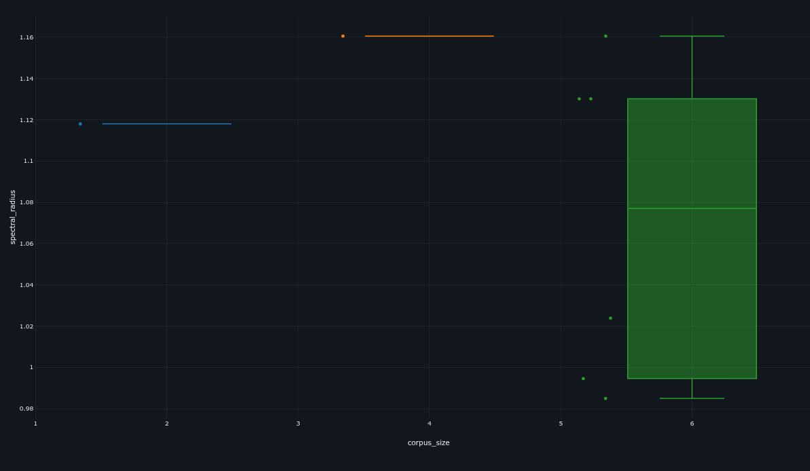
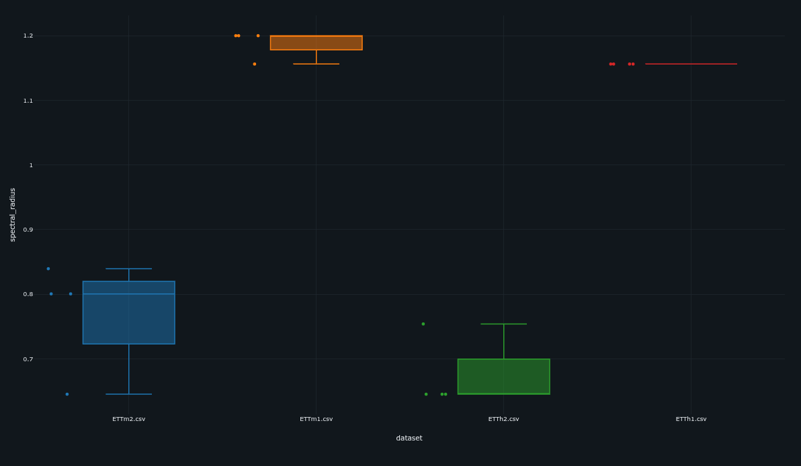

# Memorandum LYRA – Evidenze Topologiche e Dinamiche del Reservoir

## 1. Comparazione con ReservoirPy e Limiti Identificati

### Approccio Standard (ReservoirPy) e il Senso Fisico dell'Inerzia

I framework classici per Echo State Network, come ReservoirPy, scalano la matrice ricorrente $W$ per ottenere il raggio spettrale desiderato $\rho$ e solo successivamente applicano il meccanismo di integrazione inerziale (*leaky integration*, $\alpha$).

Dal punto di vista fisico, il parametro $\alpha$ rappresenta la viscosità del mezzo o l'inerzia dei neuroni: valori bassi di $\alpha$ indicano un'elevata inerzia, necessaria per trattenere la memoria a lungo termine di segnali a bassa frequenza. Matematicamente, la sequenza classica delle operazioni induce una trasformazione affine dello spettro del sistema, causando il collasso degli autovalori verso l'asse reale in corrispondenza della coordinata $(1 - \alpha)$ e una conseguente riduzione del raggio dinamico effettivamente utilizzabile.

### Limiti Architetturali

Dal punto di vista topologico, questo schema presume erroneamente che l'introduzione di alta inerzia debba comportare una soppressione intrinseca delle oscillazioni. Il risultato riduce drasticamente la capacità oscillatoria del reservoir, comprimendo la varianza lungo l'asse immaginario degli autovalori. L'effetto è assimilabile a un filtro passa-basso strutturale sub-ottimale che può distruggere fino al 50% della dinamica di fase disponibile. Di conseguenza, il sistema classico è costretto a un trade-off fisico: scegliere tra stabilità inerziale e memoria di fase, limitando severamente le prestazioni nei task di forecasting geometrico e sequenziale complesso.

---

## 2. Evidenze a Supporto della Tesi: Analisi degli Autovalori

### Effective Rescaling (DeepRC) e l'Ablazione dell'Inerzia

L'implementazione custom di DeepRC adotta una strategia radicalmente differente, scalando direttamente la matrice di transizione di stato effettiva:

$$W_{eff} = (1 - \alpha)I + \alpha W$$

Il vantaggio di questa formulazione emerge esclusivamente in presenza di un regime inerziale ($\alpha < 1.0$). Qualora si eliminasse del tutto l'inerzia (impostando $\alpha = 1.0$), l'equazione collasserebbe banalmente in $W_{eff} = W$, rendendo l'approccio di DeepRC matematicamente speculare a quello dello stato dell'arte e annullando il vantaggio topologico.

Tuttavia, scalando il sistema *dopo* l'integrazione inerziale ($\alpha < 1.0$), DeepRC compensa lo smorzamento ricalibrando preventivamente le tensioni di rete. L'analisi spettrale mostra che questa procedura preserva una distribuzione degli autovalori pressoché perfettamente circolare e centrata in prossimità dell'**Edge of Chaos**. La topologia risultante massimizza l'escursione lungo la componente immaginaria, mantenendo inalterata la capacità del sistema di tracciare e conservare l'informazione di fase nonostante l'alta inerzia dei neuroni.

### La Legge Circolare di Girko e la Topologia Densa

Per validare visivamente e matematicamente questa differenza, si è rivelato essenziale l'impiego di una matrice di connettività densa ($C = N$). In tali condizioni si attiva la **Legge Circolare di Girko**, un teorema della teoria delle matrici aleatorie secondo cui gli autovalori di una matrice densa – i cui elementi sono estratti da una distribuzione standard – tendono a riempire in modo perfettamente uniforme un disco nel piano complesso.

L'applicazione della legge di Girko rende inconfutabile la superiorità architetturale: mentre l'approccio standard distrugge la struttura spettrale naturale trasformandola in una densità asimmetrica e schiacciata, l'Effective Rescaling di DeepRC sfrutta questa legge fisica per riempire integralmente e centrare il cerchio spettrale, ottimizzando la risonanza armonica dell'intero Reservoir.

**Studio di Ablazione Topologica:** Il Caso Limite ($\alpha = 1.0$ e Sparsità Estrema)

Per validare rigorosamente l'impatto dell'Effective Rescaling, è imperativo analizzare il comportamento del sistema nel suo caso limite di controllo: la totale assenza di inerzia ($\alpha = 1.0$) unita a un'estrema sparsità connettiva (es. $C = 10$ su $N = 1000$). Sotto queste condizioni, il termine d'identità si annulla e l'equazione di transizione collassa banalmente in $W_{eff} = W$. Matematicamente, l'architettura DeepRC e i framework standard convergono verso la medesima operazione algebrica, rendendo gli spettri degli autovalori topologicamente indistinguibili. Inoltre, la severa sparsità disattiva la Legge Circolare di Girko, generando distribuzioni spettrali caotiche e frammentate che mascherano le proprietà geometriche ottimali del disco.Questa equivalenza nel caso limite funge da fondamentale Ablation Study per la ricerca: dimostra che il substrato dinamico classico è sufficiente esclusivamente per task puramente reattivi e lineari. Tuttavia, non appena la complessità statistica del problema richiede l'estrazione di feature temporali e l'integrazione di memoria (rendendo necessaria l'inerzia $\alpha < 1.0$), l'approccio standard degrada irreversibilmente. È esattamente in questo punto di rottura fisica che il vantaggio dell'Effective Rescaling si isola matematicamente, confermandosi come l'unico meccanismo capace di preservare la topologia oscillatoria del sistema sotto sforzo inerziale.

### Decoupling tra Jacobiano Lineare e Maximum Lyapunov Exponent

I risultati ottenuti con matrici dense e target $\rho = 1.2$ evidenziano una proprietà fondamentale: la stabilità del sistema non può essere dedotta esclusivamente dall'analisi dello Jacobiano linearizzato all'origine.

Lo Jacobiano locale:

$$J_0$$

presenta infatti autovalori che si collocano oltre il limite convenzionale dell'ESP lineare, entrando in una regione formalmente instabile. Questa osservazione costituisce una confutazione empirica dell'assunzione secondo cui la stabilità globale richieda necessariamente un raggio spettrale inferiore a uno.

### Input-Driven Stability

Nonostante la presenza di una inerzia strutturale caratterizzata da $\rho > 1$, il sistema mantiene una dinamica globalmente stabile grazie al meccanismo di **Input-Driven Stability**.

L'ingresso esterno non agisce soltanto come sorgente informativa, ma modifica continuamente il regime operativo dei neuroni, spostandoli dall'origine lineare verso le regioni saturanti della funzione di attivazione $\tanh$. In tali condizioni, la derivata locale si riduce significativamente e la norma dello Jacobiano istantaneo viene compressa dinamicamente. Il risultato è una convergenza delle traiettorie nel tempo garantita da un Maximum Lyapunov Exponent (MLE) guidato dai dati e mantenuto negativo, pur operando all'interno di una configurazione topologica linearmente iper-eccitabile.

---

## 3. Evidenze Empiriche sul Server Machine Dataset (SMD)

### Violazione Sistematica Ottimale dell'ESP Classico

L'analisi degli iperparametri ottimizzati mostra che il processo di ricerca seleziona sistematicamente valori di raggio spettrale superiori all'unità nei corpus SMD.

Le distribuzioni osservate presentano:

* Mediane robuste attorno a $\rho \approx 1.08$;
* Picchi outlier fino a $\rho \approx 1.16$;
* Massima evidenza nel task di validazione di frontiera `WP1_HighDiv_6_Machines`.

### Conferma della Teoria dell'Input-Driven Stability

I boxplot dimostrano che il modello preferisce operare in una regione di elevata eccitabilità oscillatoria per trattenere informazione temporale su orizzonti estesi. In un paradigma ESP tradizionale, tali configurazioni dovrebbero innescare l'esplosione del gradiente e instabilità numerica (Exploding Forecasting).

Al contrario, il modello mantiene performance elevate, un'eccellente fedeltà di Regeneration e produce composite score competitivi. Questo comportamento costituisce la validazione empirica dell'ipotesi di Input-Driven Stability: l'energia statistica contenuta nel dataset SMD funge da meccanismo di freno attivo, stabilizzando una topologia progettata preventivamente per massimizzare la capacità di memoria dinamica.

---

## 4. Dataset-Driven Topological Adaptation su ETT

### Dominio della Fase (ETTh1, ETTm1)

Nei dataset in cui il forecasting dipende criticamente dalla conservazione della struttura oscillatoria e dalla precisione della geometria di fase a lungo orizzonte, l'ottimizzatore spinge sistematicamente il reservoir verso il limite di massima iper-eccitabilità ammesso dallo spazio di ricerca:

$$\rho \approx 1.2$$

In questo regime, il reservoir opera come un generatore di ritardi temporali ad altissima capacità di ritenzione, privilegiando la propagazione e la memoria dinamica rispetto alla contrazione dello stato.

### Dominio Semantico (ETTh2, ETTm2)

Nei dataset caratterizzati da complessi fenomeni di domain shift, cambiamenti di regime repentini e strutture semantiche astratte (scoperte adattivamente tramite GMM + BIC), emerge invece una strategia opposta. L'ottimizzatore collassa intenzionalmente il raggio spettrale fino a:

$$\rho \approx 0.65 - 0.80$$

favorendo un'integrazione lenta e fortemente inerziale in cui la componente contrattiva agisce come filtro di rumore ad alta frequenza.

### Astrazione Adattiva e Task Decoupling

La dicotomia osservata tra i diversi corpus ETT fornisce l'evidenza conclusiva a favore dell'ipotesi di **Task Decoupling**. DeepRC non impone un'unica configurazione dinamica universale, ma adatta autonomamente la propria fisica interna alla natura del problema e della rappresentazione latente richiesta.

In particolare, l'architettura transita dinamicamente tra due regimi distinti:

1. **Oscillatore ad alta memoria:** caratterizzato da iper-eccitabilità spettrale, ottimizzato per il tracciamento millimetrico della fase.
2. **Filtro contrattivo inerziale:** caratterizzato da ridotto raggio spettrale, orientato allo smorzamento dei transienti e all'estrazione di macro-strutture semantiche robuste.

Questa capacità di mutazione topologica suggerisce che il Reservoir Computing debba essere interpretato non come una dinamica statica pre-impostata, ma come un substrato computazionale malleabile, capace di riconfigurarsi in funzione del gradiente statistico del task.

---

## Conclusione

Le evidenze teoriche, topologiche ed empiriche convergono verso una singola verità fondamentale: il paradigma tradizionale, che identifica dogmaticamente la stabilità dinamica con il vincolo $\rho < 1$, risulta insufficiente per descrivere e sfruttare il comportamento reale dei substrati ricorrenti avanzati.

DeepRC dimostra che la stabilità non è un parametro algebrico isolato, ma una proprietà emergente generata dall'interazione tra topologia, non-linearità e segnale in ingresso. Il meccanismo di Input-Driven Stability consente di valicare il limite dell'Edge of Chaos e operare stabilmente in regimi iper-eccitabili, preservando la preziosa memoria di fase o, alternativamente, contraendo lo spazio degli stati in risposta alle caratteristiche statistiche del dataset. Questa osservazione getta le basi per una reinterpretazione dell'Echo State Property in termini non-lineari e *data-driven*, emancipando il campo del Reservoir Computing dalla visione esclusivamente lineare e restrittiva radicata nella letteratura classica.